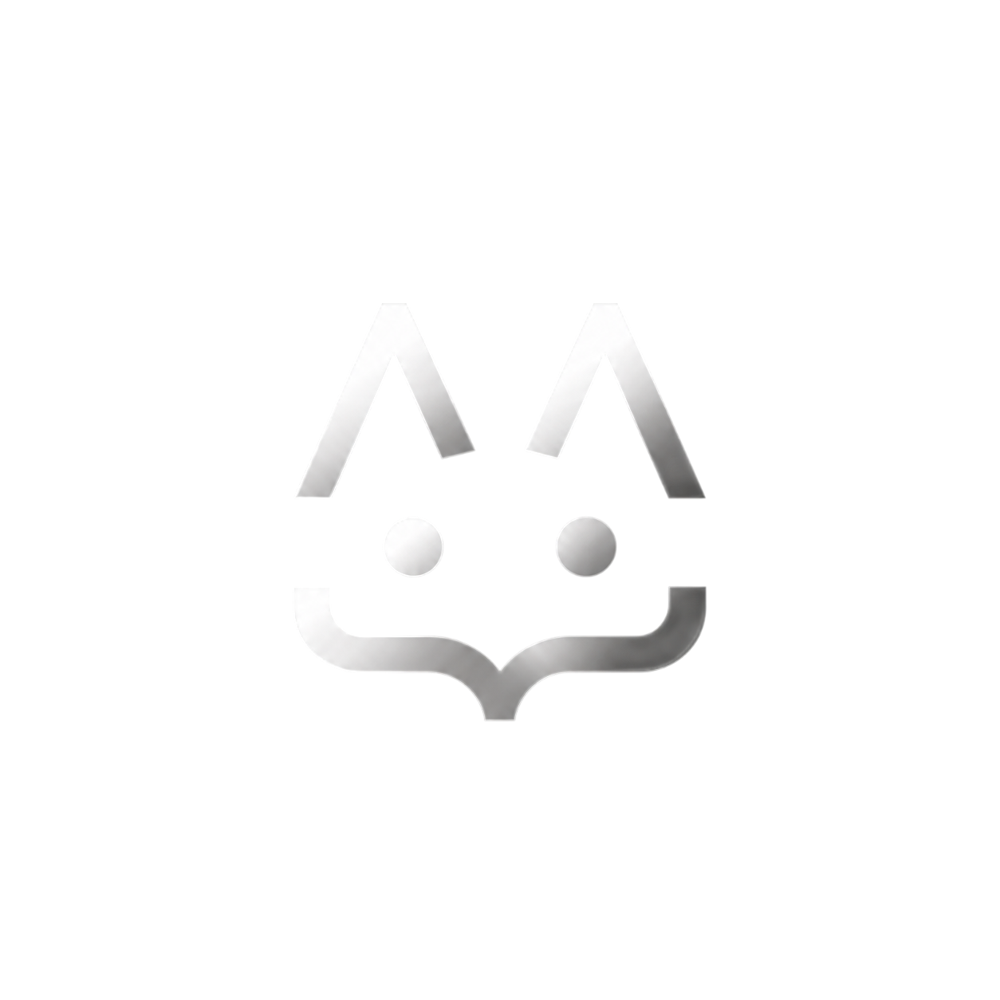

# mori

### a quieter place to write code.

**minimal · lightweight · open source**

 

 

a minimal code editor designed for developers who value simplicity, performance, and a clean workspace.

[features](#features) · [built with](#built-with) · [getting started](#getting-started) · [roadmap](#roadmap)

---

## about

**mori** is an open-source code editor focused on providing a fast, minimal, and distraction-free development experience.

built around a monochrome design language, mori combines a familiar editing experience with a carefully crafted interface.

the goal is simple: less visual noise, more focus on writing code.

## features

| feature | status |
| :--- | :--- |
| monochrome interface | implemented |
| Monaco editor | implemented |
| syntax highlighting | implemented |
| multiple editor tabs | implemented |
| tab switching and closing | implemented |
| file explorer UI | implemented |
| file-type icons | implemented |
| custom dropdown menus | implemented |
| real filesystem access | planned |
| integrated terminal | planned |
| command palette | planned |
| native desktop application | planned |

## built with

### frontend

| language / framework | purpose |
| :--- | :--- |
| **TypeScript** | frontend application logic |
| **JavaScript** | web functionality |
| **React** | component-based interface |
| **HTML** | interface structure |
| **CSS** | styling |
| **Tailwind CSS** | utility-first styling |
| **shadcn/ui** | interface components |
| **Lucide** | iconography |
| **Monaco Editor** | code editing |
| **Vite** | development tooling |

### native & systems — planned

| language / framework | purpose |
| :--- | :--- |
| **Rust** | native backend and systems integration |
| **Tauri** | desktop application framework |
| **C** | low-level systems experimentation |
| **C++** | performance-oriented native components |

### target languages

C · C++ · Rust · Python · TypeScript · JavaScript · Go · Zig · Java · Lua · HTML · CSS · JSON · Bash

language support will expand as mori develops.

## getting started

**requirements:** Node.js and npm.

Clone and start the development server:

    git clone https://github.com/calebcat300-gif/mori.git
    cd mori/frontend
    npm install
    npm run dev

## roadmap

- [x] design the editor interface
- [x] integrate Monaco
- [x] implement file explorer UI
- [x] add multiple editor tabs
- [x] implement tab closing and switching
- [x] add file-type icons
- [ ] connect editor tabs to real file contents
- [ ] implement filesystem integration
- [ ] open and save local projects
- [ ] add native desktop integration
- [ ] build integrated terminal
- [ ] implement command palette
- [ ] add editor settings and customization
- [ ] expand language tooling

## contributing

mori is in early development. contributions, suggestions, and feedback are welcome.

---

**mori.**

less interface. more intention.

